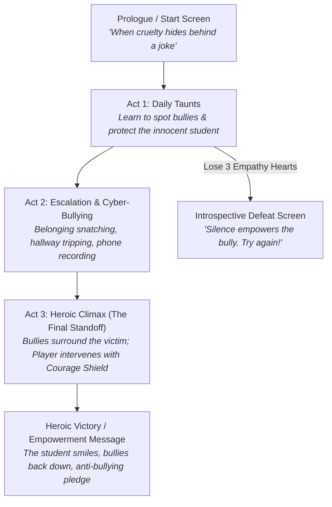

# 🎓 "Mazak Tha?" (Just a Prank?) — Anti-Bullying Whack-A-Mole Transformation Plan

---

## 📌 Executive Summary

### The Core Theme
In schools and colleges, bullying and harassment are frequently trivialized. Bullies hit, snatch belongings, mock, trip, and humiliate weaker or quiet peers, and when confronted, dismiss their actions with a casual laugh:
> **"Chill bro, it was just a prank!" / "Arey bhai, Mazak Tha!" (مذاق تھا)**

This project transforms the existing high-energy **2.5D Whack-A-Mole** game into an **educational and empowering arcade experience**. The game preserves fast-paced, satisfying arcade mechanics while subverting the traditional "blind whacking" reflex to teach empathy, active intervention, and the courage to break the bystander effect.

---

## 🎯 Game Flow & Narrative Arc

---

## 🎭 The 3-Entity System (Subverting Whack-A-Mole)

Currently, the player hits any mole that appears. To deliver the theme, three distinct entities will pop up from the holes:

| Entity | Role & Behavior | Player Action | Consequence |
| :--- | :--- | :--- | :--- |
| **The Bully**  *(Troublemaker)* | Pops up with a mocking smirk, throwing taunts or reaching out to harass. | **WHACK!** (Call out / Stop) | Bully recoils dizzy with popups: *"Mazak tha!", "Chill!", "Can't take a joke?!"*. Increases **Courage Meter**. |
| **The Innocent Student**  *(Target of Bullying)* | Pops up holding school books, looking nervous, cowering or looking for help. | **DO NOT HIT!** (Protect) | Leaving them safe awards empathy points. **If struck by accident**: Deducts 1 Empathy Heart! Screen flashes with alert: *"PROTECT, DON'T HURT!"* |
| **The Filming Bystander**  *(Cyber Bully)* | Holds up a smartphone with a flashing red REC light to record the humiliation for social media. | **PRIORITY WHACK!** (Disable camera) | Knocks down the camera before footage uploads. Prevents viral mockery. |
| **The Enraged Bully (Red Mode)** | When confronted repeatedly, becomes aggressive/defensive (*"Who do you think you are?!"*). | **TIMED DODGE / BLOCK** | Retains existing red rage explosion hazard if attacked blindly without a shield. |

---

## 🏫 Real-World Bullying Scenarios Featured in Gameplay

During gameplay, the game cycles through recognizable school/college harassment dynamics:

1. **Verbal Demoralization & Nicknaming**:
   - Floating speech bubbles in Urdu & English: *"Bewakoof!"*, *"Namoona!"*, *"Chomu!"*, *"Loser!"*, *"Nalaiq!"*, *"Look at him!"*.
   - Whacking the bully shatters the insult into fragments and displays the defensive excuse: *"Arey Mazak Tha!"*.

2. **The "Monkey in the Middle" (Belonging Snatching)**:
   - Two bullies pop up in adjacent holes passing the victim’s backpack or notebook back and forth.
   - The player must whack the active holder before the timer expires to return the bag to the student.

3. **Hallway Tripping & Shoving**:
   - Bully pops up extending a foot or shoulder towards a neighboring innocent student.
   - Quick reaction whacks the bully before the student is knocked down.

4. **The "Content Creator" (Cyber-Bullying)**:
   - Bystander recording with phone. If ignored for too long, a notification banner flashes: *"Video Uploaded to Group Chat: 😭 Victim Humiliated"*, penalizing score.

5. **The Gaslighting Shield ("Mazak Tha" Mask)**:
   - Late-game bullies wear a smiling comedy mask or hold a *"Just a Joke"* sign. Striking them shatters the mask to reveal the ugly harassment underneath.

---

## 🛡️ The Heroic Climax: "Stand Up & Save the Student"

Instead of an endless game over, the game leads to an exhilarating **Heroic Standoff**:

### Phase 1: The Cornering (Narrative Shift)
- Once the player accumulates enough **Courage Points** (or survives the school week stages), normal spawns stop.
- The background lights dim into a moody afternoon courtyard.
- The **Innocent Student** appears trapped in the central hole, visibly distressed as gang members emerge in surrounding holes closing in.

### Phase 2: The Defense Rush (Quick-Time Protection)
- The player’s hand transitions from an aggressive punch to a **Heroic Hand / Protective Shield (✋)** with a golden courage aura.
- Bullies attempt coordinated lunges at the student from left, right, and top.
- The player must tap rapidly to intercept and block each attack before it reaches the victim.

### Phase 3: The Breakthrough & Confrontation Dialogue
- Upon deflecting the final bully:
  - Bully shouts: *"Kyun beech mein aa raha hai? Mazak tha!"* (Why are you interfering? It was just a joke!)
  - The Heroic Voice / Message flashes:
    > **"Harassment is NOT a joke. Real humor brings people together; it doesn't break someone's spirit!"**
    > **"مذاق وہ ہوتا ہے جس میں سب ہنسیں، کسی ایک کا دل نہ ٹوٹے!"**
- The bullies look defeated, drop their excuses, and walk away.
- The innocent student stands upright, smiles, and hugs their books with confidence.

---

## 💡 Post-Game Reflection & Anti-Bullying Takeaways

When the game concludes (either Victory or Defeat), a beautifully designed **Impact Modal** appears instead of a plain score card:

### 1. The Psychology of "Mazak Tha"
Explains how bullies use "humor" as **plausible deniability** to escape punishment and make the victim feel like they are "too sensitive".

### 2. The Power of the Upstander
Shows the difference between a **Bystander** (who laughs, records, or stays silent) and an **Upstander** (who stands beside the victim and says "Stop").

### 3. Actionable Checklist for Students
- **Don't laugh along**: Deprive the bully of their audience.
- **Support the target**: Check in on the victim after the incident (*"Are you okay? That wasn't funny."*).
- **Report with confidence**: Tell a counselor, teacher, or trusted adult.

---

## 🔧 Technical Implementation Architecture

The existing modular codebase provides an ideal foundation:

| File | Proposed Modifications |
| :--- | :--- |
| [`src/Config.js`](file:///c:/Users/KamiKaze/Documents/GitHub/Whack-A-Mole/src/Config.js) | Add entity types (`BULLY`, `VICTIM`, `RECORDER`), Courage score thresholds, scenario timers, and Climax triggers. |
| [`src/MoleController.js`](file:///c:/Users/KamiKaze/Documents/GitHub/Whack-A-Mole/src/MoleController.js) | Support distinct visual states: Bully taunting, Victim timid idle, Bully recoiling with *"Mazak Tha!"* banner, and Student celebration. |
| [`src/MoleSpawner.js`](file:///c:/Users/KamiKaze/Documents/GitHub/Whack-A-Mole/src/MoleSpawner.js) | Implement paired scenario spawns (e.g. Bully next to Victim), phone bystander logic, and Climax siege formation. |
| [`src/HammerController.js`](file:///c:/Users/KamiKaze/Documents/GitHub/Whack-A-Mole/src/HammerController.js) | Add "Stop / Shield Hand" (✋) mode for intervention and protection feedback during the Climax. |
| [`src/VFXManager.js`](file:///c:/Users/KamiKaze/Documents/GitHub/Whack-A-Mole/src/VFXManager.js) | Add speech bubble popups for Urdu/English insults (`HumanHit(TEXT).txt`), "Mazak Tha" gaslight shields, and golden courage aura particles. |
| [`src/AudioManager.js`](file:///c:/Users/KamiKaze/Documents/GitHub/Whack-A-Mole/src/AudioManager.js) | Add procedural hallway murmurs, camera clicks, warning buzzer on hitting the victim, and triumphant heroic brass chords for the climax. |
| [`src/GameManager.js`](file:///c:/Users/KamiKaze/Documents/GitHub/Whack-A-Mole/src/GameManager.js) | Orchestrate the 3 game phases (Act 1, Act 2, Heroic Climax), track Empathy Hearts and Courage Meter, and trigger the Heroic resolution. |
| [`style.css`](file:///c:/Users/KamiKaze/Documents/GitHub/Whack-A-Mole/style.css) | HUD updates: Empathy hearts, Courage progress bar, Active Scenario ticker, and rich glassmorphic Heroic Resolution modal. |
| [`build.ps1`](file:///c:/Users/KamiKaze/Documents/GitHub/Whack-A-Mole/build.ps1) | Bundles the updated modules and styles directly into `index.html` and `whack-a-mole-standalone.html`. |

---

## 🎨 Visual Presentation Strategy

To ensure students immediately recognize the characters without losing the polished aesthetic:
1. **Bully Sprites**: Expressive school-age avatars (smug grin, backwards cap, school tie, or pointing finger).
2. **Victim Sprites**: Gentle student avatar with glasses, school notebook/bag, transitioning from sad/cowering to relieved/smiling.
3. **Camera Bystander**: Student holding a smartphone with an animated recording indicator.
4. **Comic Hit & Excuse Bubbles**: High-contrast, vibrant text popups with bold typography alternating between the bully's taunt and their retreat excuse (*"MAZAK THA!"*).

---

## 📋 Implementation Milestones

1. **Phase 1: Scenario & Dialogue System**
   - Integrate Urdu/English school taunts and the signature "Mazak Tha!" retreat popups on impact.
2. **Phase 2: The Multi-Entity Spawner (Bully vs. Victim)**
   - Introduce the Innocent Student that players must avoid hitting, and the Filming Bystander.
3. **Phase 3: The Heroic Climax & Protection Mechanic**
   - Build the interactive boss/siege sequence where the player shields the surrounded student.
4. **Phase 4: Audio, HUD & Educational Modal**
   - Implement the Courage/Empathy HUD, procedural school soundscapes, and the impactful post-game reflection cards.
5. **Phase 5: Bundling & Verification**
   - Run `build.ps1`, verify smooth 60fps canvas performance and responsive controls on desktop and mobile.
